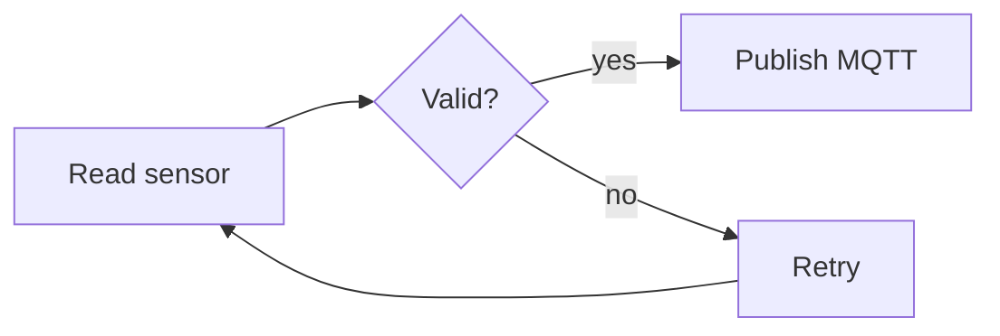
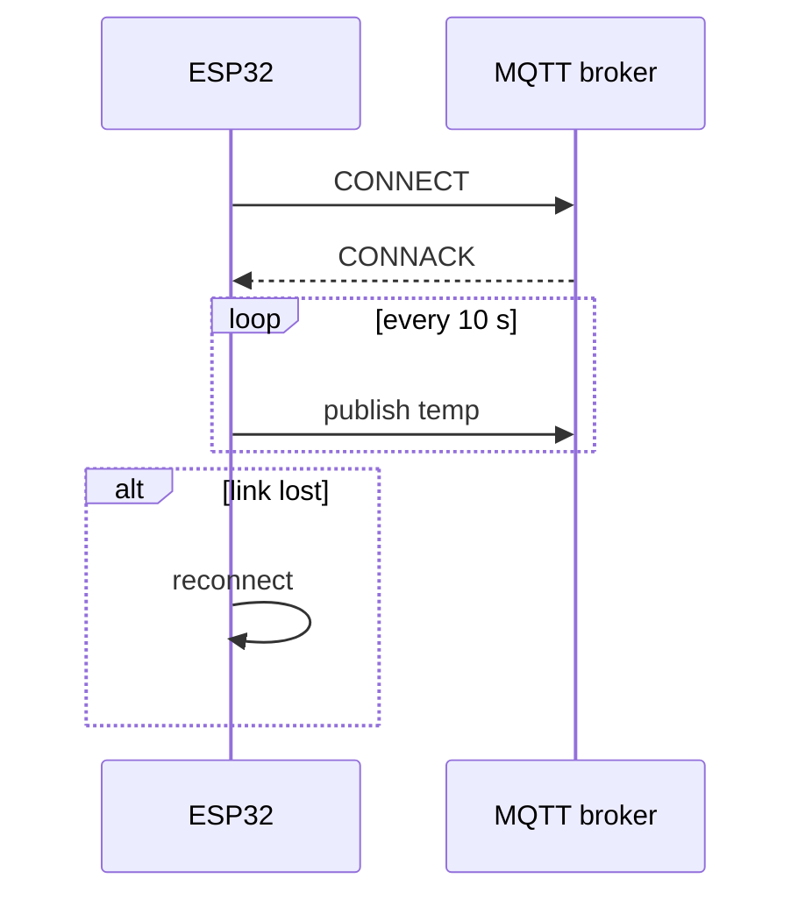
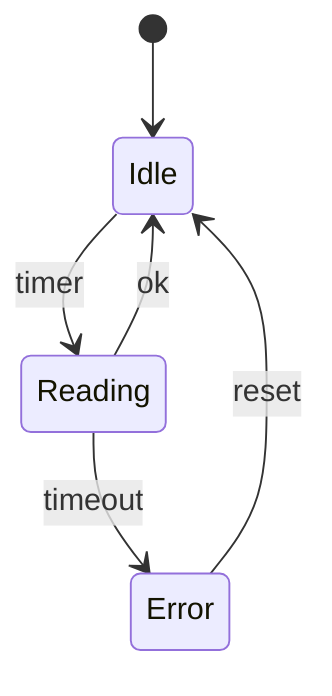
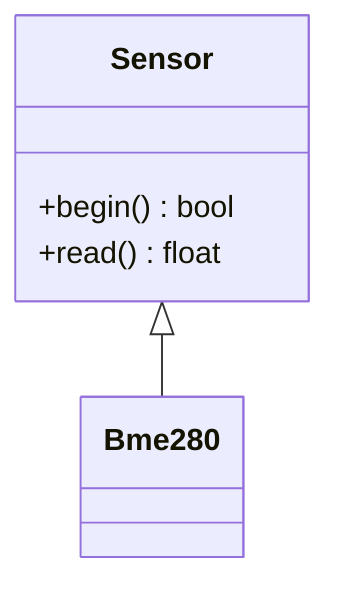
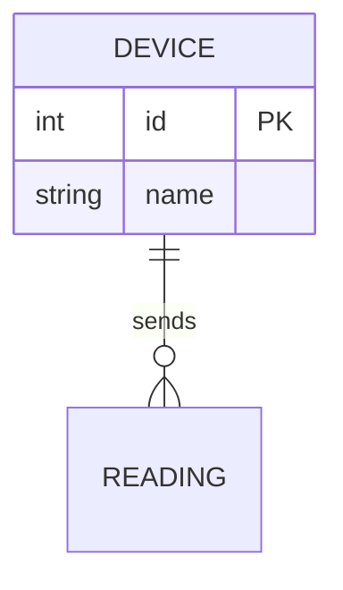
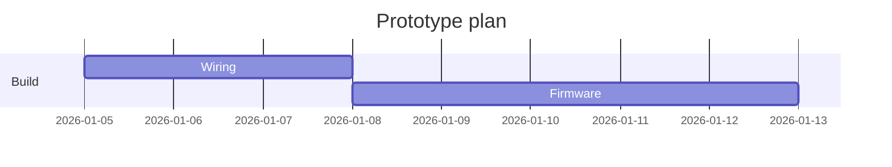

# Mermaid diagram syntax

The chat renders a fenced mermaid block with Mermaid's strict security level. Invalid syntax shows as plain text, so keep diagrams simple and exact. One or two diagrams per answer, each with a one-line explanation.

## Blocked (never use)
`click`, `href`, links, `callback`, `javascript:`, `%%{ init }%%` directives, front-matter config or themes, HTML in labels, `style` and `classDef` colour tweaks. Plain `%%` comments are fine but rarely needed.

## General rules
- First line declares the type. Keep to about 15 nodes or fewer; split large systems into several small diagrams.
- Short labels (a few words). Put detail in your text, not the diagram.
- Quote any label with symbols, brackets, colons or non-ASCII: `A["Temp (°C)"]`, `B["GPIO 4: data"]`.
- Node ids are plain words without spaces (`sensor`, `mcu`). Reserved words like `end` break flowcharts; write `End` or `done`.
- Unknown words or misspelled keywords break the whole diagram. Indent with two spaces.

## Which type
| Need | Type |
|---|---|
| Process, algorithm, decisions, data path | flowchart |
| Messages between devices, cloud, app | sequenceDiagram |
| Device modes and transitions | stateDiagram-v2 |
| Software structure | classDiagram |
| Data tables and relations | erDiagram |
| Timeline or project plan | gantt |

## Flowchart

- Directions: `TD` top-down or `LR` left-right. Shapes: `[box]`, `(round)`, `{decision}`, `([stadium])`, `[(database)]`.
- Edge labels: `A -- text --> B` or `A -->|text| B`. Group with `subgraph Name` ... `end`.

## Sequence diagram

- `->>` solid request, `-->>` dashed reply. Blocks: `loop`, `alt`/`else`, `opt`, `par`, each closed with `end`. Notes: `Note over Dev,MQ: text`.

## State diagram

## Class and ER

- Class relations: `<|--` inherits, `*--` composition, `o--` aggregation, `-->` association. ER cardinality: `||` one, `o{` zero or many, `|{` one or many.

## Gantt

## Mistakes to avoid
Unquoted parentheses in labels; labels with line breaks or HTML; duplicate ids with different text; very wide LR flows on phones (prefer TD for long chains); drawing wiring as Mermaid when the wiring block fits better.

Adapted from https://skills.sh/softaworks/agent-toolkit/mermaid-diagrams (MIT, Copyright (c) 2026 Leonardo Flores).
