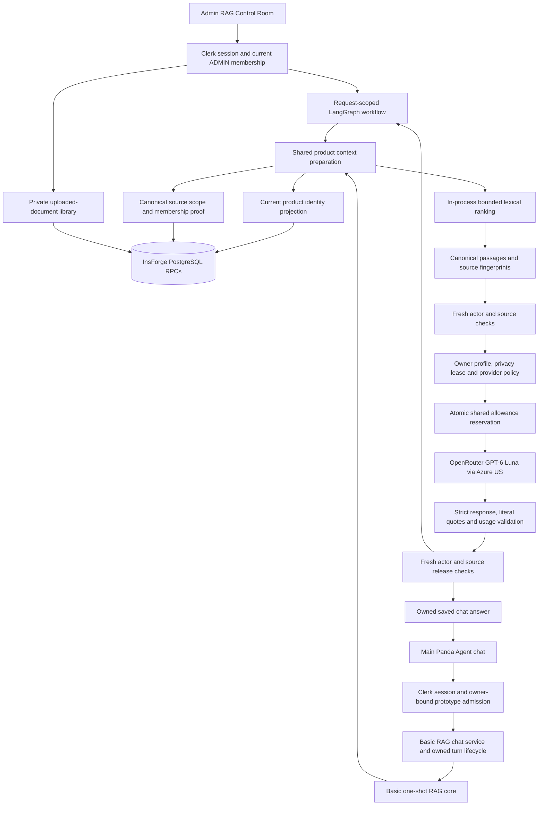
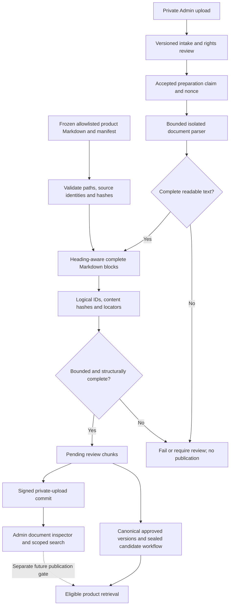

# Current RAG system: implementation and engineering handoff

## Latest hosted provider release, 10 November 2026

Runtime `739e0da` is promoted as `dpl_ADhJaJJ19NtUhUzyH8ffPwWHV8zR`. Hosted main chat and Control Room use GPT-OSS 20B pinned to Groq through OpenRouter; native/local Luna profiles and ledger remain untouched. A matched nine-case comparison measured provider medians 637 ms versus Luna 1,893 ms, with about 23% lower total cost, under the same quote-ID protocol. Small samples are not an SLA. Exact source quote IDs, final receipts, strict fresh ZDR, source/access checks and single dispatch remain enforced; hidden reasoning is excluded and counted. Hosted owner testing remains uncapped at application level.

472 affected tests pass without failures/skips. Actual candidate and primary browser tests pass grounded answers, editable drafts, saved reload, unsupported physical revision and a newly repaired explicit project name/deadline memory route. Live document HTTP took 679 ms and main context was ready in 773/831 ms. Main full answers took 4,927/7,912 ms, including provider round trips of 779/3,329 ms. Per-call safe observations and actual metadata-only LangSmith traces confirm provider variance and remaining application overhead. The first candidate's semantic error and routing failure were retained and repaired before promotion. See [the measured release](Panda-agent/docs/control-room/fast-provider-20261110.md) and [numeric receipt](Panda-agent/docs/verification/fast-provider-20261110.json). Hosted private-pack Evaluation configuration and full native/OpenCode acceptance remain separate. Dated releases below are historical.

## Latest incident repair, 10 November 2026

The disabled-input and rejected-grounding fixes are live from runtime `2580c56`, deployment `dpl_6gfexKchKs4VYVWMBzwEaRkdSfX3`. Drafting works during running/blocked requests while sending remains guarded. Whitespace-equivalent quotes become exact source literals; distinct same-passage quotations now validate; known rejected output finishes safely rather than trapping the chat. 424 affected tests pass without failures/skips, including both unchanged 20-case retrieval regressions. Signed-in candidate and main-domain tests passed for grounded answers, follow-ups, saved reload and abstention. Primary-domain document HTTP responses took 687/853ms; main first stream data 987/1055 ms. Full answers varied 3.67–23.90seconds, including a 19.86-second provider outlier; no complete-answer SLA is claimed. Hosted owner/Admin testing remains uncapped at application level. See [incident evidence](Panda-agent/docs/control-room/input-rag-incident-20261110.md). The private hosted Evaluation pack and full native/OpenCode acceptance remain separate; dated releases below are historical.

## Main Panda Agent integration, 10 November 2026

The owner authorized connecting the working RAG to the main Panda Agent chat and removing its cumulative application testing cap. This supersedes the earlier main-chat RAG deferral and earlier separation of general-chat budgets below. The original local/native ledger is untouched. Product, unknown-model and unsupported specification questions use RAG, quoted sources and honest clarification/abstention. General conversation retains the verified same-chat memory from 139fa22. Short product follow-ups carry only the latest verified same-chat identity and retrieve fresh sources. Ambiguous or long references and multiple-product questions clarify rather than guessing.

Server-only Production flags PANDA_AGENT_MAIN_RAG_ENABLED and PANDA_AGENT_MAIN_CHAT_UNCAPPED enable the existing hosted owner/Admin profile. Migration 20261110150000_direct-unmetered.sql adds signed uncapped direct claims/receipts and preserves capped history; rollback/ACL rehearsal passed and it was applied without ledger changes. The direct v2 memory wrapper remains compatible. Selection reads one fresh immutable source snapshot per request; live source/Admin checks still bracket model generation and publication. Bounded retrievalMs and server requestElapsedMs are emitted before any provider metadata request. The combined release is live as `dpl_GxKywCmkQb1EPE3VJ2ettwAwb5G3`, from runtime source `94cf4ec`. All 234 affected tests pass without skips; both frozen 20-case retrieval regressions pass. Actual primary-domain browser tests verified cited answers, short product follow-ups, source quotations, saved history, no-evidence refusal and uncapped general conversation. Lost-final-frame recovery made one POST and one read-only GET; capabilities401 recovered through a fresh-token200. The final follow-up delivered context to the browser in 1,860 ms (370 ms retrieval, 1,161 ms server admission-to-context); the complete saved model answer took 10,355 ms. These are observed samples, not a hard SLA. See [release evidence](Panda-agent/docs/control-room/main-chat-rag-20261110.md).

Earlier dated sections below retain historical evidence and do not override this scope.

## Hosted Admin grounded-answer release, 10 November 2026

The live [Control Room Playground](https://pandabyte-iot.vercel.app/admin/rag-control-room#playground) now generates grounded GPT-6 Luna answers. Eight actual model requests passed in the browser, including five on the primary domain, repeated identical questions and page reloads. Every selected quotation matched its retrieved passage. The latest primary deployment checked was `dpl_QyaEmLUPfCsHe2s4LCC9HsTHKcNb`; it retains the RAG implementation from `ab763c9`, which is included in main.

Hosted owner/Admin RAG has no application spending cap or expiring prototype lease. Its persistent deployment profile, live access/source checks, strict provider ZDR and signed single-dispatch claims remain enforced. The separate local/native and general-chat budgets are outside this change.

Five primary-domain document-only HTTP responses took 568–973 ms. The five primary-domain model HTTP responses took 3,136–3,627 ms. These are sequential observed samples, not a maximum-latency guarantee. Anonymous capability access returned 401 with private/no-store. See [the release evidence](Panda-agent/docs/control-room/hosted-grounded-20261110.md) and [numeric receipt](Panda-agent/docs/verification/hosted-grounded-20261110.json).

The deployment and hosted-answer checks below that say pending are earlier checkpoints, superseded by this verified release.

## Current completion and latency work, 10 November 2026

Latest priority: finish the Admin RAG Control Room's hosted grounded answers first. The owner asked to stop cross-chat Agent coordination and explicitly removed the production Admin RAG application spending cap for repeated personal testing. The original local/native prototype ledger remains unchanged. Hosted admission is persistent, bound to the owner, exact Production origin, key and workspace, and an explicit enable flag. Operator-attested account privacy does not constitute a fresh automatic account-settings check. The transport independently verifies the current model's strict ZDR endpoint, safety-retention and price contract before each provider request.

Vercel CLI 50.34.1 securely configured eight Production variables in the existing unfiltered-iit-ians/pandabyte-iot project, including the missing OPENROUTER_API_KEY and isolated hosted RAG settings. No secret values were printed. These settings do not update an existing deployment. The current stable deployment remains dpl_4MnbKTDQAcSLNuovVN2i4EZogLRQ, with its older disconnected GPT-4o-mini label. No new hosted model request or redeployment is claimed yet.

The new hosted policy uses the tested GPT-6 Luna/Azure grounded completion and a signed, Admin-only, persistent request claim. Migration 20261110125000_hosted-grounded-claims.sql was applied after a rollback/ACL rehearsal. The table has no direct authenticated access and the RPC denies anonymous requests. It has no budget debits or request-count cap. A live duplicate-dispatch check remains pending. Valid provider cache-read/write receipts are accepted only by the hosted transport with exact decimal price bounds; local receipt rules remain unchanged. A fresh full scoped regression passed 319 tests with zero skips.

The isolated hosted hotfix is prepared from the exact retained 672-file live source manifest 76fbbdbd27e7d94e8b7f37334d91baf415da8a440f250528d21aeed92211127e. Its original native/chat routes and retrieval files remain byte-identical. New Playground retrieval lives in an isolated deployment-only dependency directory. Dependency installation, final production build, hosted real-answer testing and promotion remain open. The full feature checkpoint is not merged or pushed to main.

The owner authorized completing the Control Room, the original 20-case runner, real-model testing, and a merge only after the complete web harness passes end to end. The latest retrieval limit is two seconds for the complete document-only HTTP response. The owner explicitly authorized removing repeated database authentication from this read path. A future vector database remains a future decision.

The owner subsequently authorized committing and pushing the tested integration to main and a Vercel redeploy after the complete acceptance gate passes. This supersedes the historical deployment exclusions below for this integration. Preserve the existing development-commerce settings and private runtime boundaries.

The original private source-visible pack is loaded through PANDA_AGENT_EVALUATION_PACK_FILE with its exact registered SHA-256. The new durable evaluator executes one exclusively claimed index per POST, saves history in InsForge, checks a current corpus fingerprint, uses server-signed writes, withholds stored model evidence after source changes, and never redispatches a completed or uncertain claim. Admins can inspect actual questions, answers, literal quotations and measured usage. The answer key stays private.

Build A36nEpgpevaQxGP-RMC9v passed all 20 cases in a live signed-in model run. Twelve factual answers matched their literal listing evidence. Eight unsupported or ambiguous questions made no model call. Reload retained every result and a duplicate completed request preserved timings and cost. The run used 5,899 input and 591 output tokens. Provider trace-reported cost was USD 0.0008854, and conservative guard-accounted cost USD 0.000973940. The earlier run remains recorded with a corrected Bluetooth wording-score failure and a P12 admission failure. P12 had no budget reservation and later passed both a separate Playground model request and the final full run.

OpenRouter native LangSmith Broadcast is configured for pandabyte-rag-evaluation, scoped to DatummAgent, with Privacy Mode and cost metadata enabled. Optional identity/request-context fields and workspace input/output logging are off. A workspace-scoped Tracing Only key expires after 30 days. Twelve real traces matched the final model run. Their input and generated output content were absent. The synthetic OpenRouter test trace is distinct from these real calls.

The original fixes add MCU/microcontroller matching, backfill valid whole evidence fragments after duplicate/oversize candidates, omit standalone source-URL labels from answer ranking, and resolve five frozen-case product identification failures. Physical in-hand revision requests abstain. The original pack was unchanged. All 20 retrieval cases passed offline and through the normal live Playground.

The optimized read path obtains one current Admin/source snapshot and performs lexical selection and proof checks on immutable request-local data. Each request fetches a new snapshot. Candidate-row locking prevents a withdrawal transaction from invalidating the release during capture. Role/source changes after capture take effect on the next document query. Model generation retains its live pre-dispatch and release checks. Private uploaded documents remain a separate Admin library.

Build qBOsRoWsd8wujg9PKBDV2 passed all 20 original questions through the ordinary Playground. Twenty warm document-only HTTP requests had median 730.5 ms and maximum 1,521 ms. First-after-idle requests still took 3.29–3.48 seconds, so the hard limit was not yet achieved at that checkpoint. The next candidate removes the redundant backend Clerk session-status lookup from document-only reads, retaining the verified active Clerk request and current SQL Admin/source admission. Cold/idle verification is in progress.

Build anC2AMAYnfena8v1MlQCc then measured twenty warm responses with median 739 ms and maximum 1,038 ms. Cold/idle responses remained 2,761–3,536 ms, with 2,257–2,748 ms in the snapshot RPC. A read-only SQL execution profile took 37.335 ms. An anonymous transport probe reproduced the delay without an authentication token. The next candidate therefore uses a dedicated bounded HTTPS keep-alive pool for the exact snapshot RPC, with per-request credentials, TLS verification, redirect refusal, decoded-body limits and no cross-request source cache. Its cold/idle browser acceptance remains pending.

The final scoped regression command passed all 288 tests with zero skips. Independent focused review found no remaining blockers in the snapshot, transport or evaluation boundaries. The full application build and complete native web-harness acceptance remain separate gates.

Disposable link rejection and private upload, permitted-rights review, preparation, inspection, search and typed withdrawal passed. Withdrawal removed passage actions, restored prepared counts, preserved audit and cleared the old preparation success notice. Signed-out retrieval returned 401 and invalid mode/index requests returned 400. Mobile light/dark checks showed no horizontal overflow.

Primary implementation references are [LangChain retrieval](https://docs.langchain.com/oss/javascript/deepagents/retrieval), [LlamaIndex production RAG](https://developers.llamaindex.ai/python/framework/optimizing/production_rag/), [Claude streaming](https://platform.claude.com/docs/en/build-with-claude/streaming), and [OpenRouter LangSmith Broadcast](https://openrouter.ai/docs/guides/features/broadcast/langsmith). The current implementation keeps a bounded retrieve-then-generate path and measures full retrieval separately from model output. REA MCP tools were unavailable. REA CLI 6.8.0 successfully statically analyzed the installed LangGraph 1.6.1 graph/state and pregel files, with the remaining 632 inventoried files outside selected analysis. Doctor reported Node 24.18.0 below its declared supported runtime and stale MCP registration. This is selected-package static evidence, not evidence of Claude or ChatGPT server internals.

Full native web-harness integration remains a separate open gate. The original main worktree also contains 502 pre-existing working-tree changes with 90 paths overlapping this feature branch. Main has not been merged. Earlier sections below are dated historical evidence.

## Retrieval repair and browser verification, 10 November 2026

The owner resumed the separate RAG repair on `codex/panda-agent-fastapi-replacement` and requested one live model check. The merge milestone is the complete web harness after end-to-end acceptance. Sections 1–16 below describe the earlier handoff and pause.

The repair plan was to reproduce five fixed queries, correct observed retrieval misses, reduce duplicate work while preserving current authorization and source checks, and compare the same requests in the authenticated Control Room.

Commit `b3a32d6` matches MCU and microcontroller as whole words. Product and native evidence selection fill up to eight passages after duplicates and over-budget hits have been skipped. The native path still bounds the serialized context and issues contiguous evidence aliases. The main-chat RAG core removes a repeated actor check where the same authorization callback brackets fresh source reads. The synthetic count fell from seven to six on that path. The Documents view now labels the two private upload counts as prepared. Its 46-row table also includes two withdrawn upload records.

The private captured snapshot test uses the real ranking and membership checks with fixture RPCs and synthetic actor/SKUs. Set `PANDA_TEST_RAG_SNAPSHOT` to the absolute path of the existing ignored `Panda-agent/artifacts/phase-4/native-snapshot.json`. After the URL-label fix in `2ea6469`, all 205 RAG, chat, document and workflow tests passed in a clean checkout with zero skips. The shared feature worktree passed all 221, including in-progress tests outside that commit. The production build and scoped ESLint checks passed.

| Signed-in Playground query | Baseline elapsed | Candidate elapsed | Candidate outcome |
| --- | ---: | ---: | --- |
| Which MCU does the PandaByte x8266 use? | 3,398 ms | 3,301 ms | Four passages, including the specification naming ESP8266 |
| Which USB connector does the PandaByte x8266 use? | 4,101 ms | 3,799 ms | Four passages, including USB Type-C |
| What is the maximum GPIO input voltage on the PandaByte x8266? | 1,353 ms | 3,807 ms | Insufficient evidence |
| Which ESP32 board has 8 MB of PSRAM? | 1,336 ms | 1,347 ms | Clarification |
| Which USB connector does the PandaByte x8266 use, and what is its maximum GPIO input voltage? | 1,321 ms | 6,493 ms | Insufficient evidence |

Each cell is one sequential retrieval-only request on localhost. Baseline build `dnJaZh3sWQuP5Dxgxbwt4` and candidate `EsZgnC8nJ-RUHmqj8k2E9` used the development services. Two positive queries were faster and three negative or ambiguous queries were slower. These samples do not establish an overall latency improvement. This intermediate candidate ranked a source-URL-only passage above the MCU specification. Commit `2ea6469` excludes that exact standalone label from answer candidates and retains the URL in citations and Admin inspection. On the captured snapshot, both positive queries returned three passages with the explicit specification second.

The final production build `FhHPBZNqv_CJG3LGjRDcz` passed the same five retrieval-only questions in signed-in Brave on localhost:3020. Both positive answers returned three passages (2,432 characters) with the factual listing prose first and the explicit specification second. All three other questions returned zero passages. Generation was disabled for these five checks.

| Query | Final elapsed | Final result |
| --- | ---: | --- |
| x8266 MCU | 3,322 ms | Microcontroller: ESP8266 |
| x8266 USB | 3,312 ms | USB Interface: USB Type-C |
| x8266 maximum GPIO input voltage | 1,329 ms | Insufficient evidence |
| ESP32 board with 8 MB of PSRAM | 1,295 ms | Clarification |
| x8266 USB and maximum GPIO input voltage | 1,623 ms | Insufficient evidence |

The separate paid check used `openai/gpt-6-luna` on the existing localhost:3001 production preview after fresh signed-in Brave privacy checks and a key/workspace match. The Playground returned **“The PandaByte x8266 uses the ESP8266 MCU.”** Its selected quote was **“ESP8266-based microcontroller board”** from the [PandaByte listing](https://www.pandabyte.in/product-page/pandabyte-x8266-wifi-development-board). The app reported 279 input tokens, 54 output tokens, USD 0.00006039, 24,582 ms elapsed, 9,384 ms admission, 2,846 ms model roundtrip and 7,913 ms context revalidation. These intervals overlap. Remaining conservative allowance displayed to three decimals moved from USD 0.982 to USD 0.980. The two-passage input identifies this as the pre-repair preview. Open acceptance items include paid generation on the candidate build and full native web-harness end-to-end verification.

**Checkpoint: 10 November 2026.** Branch `codex/panda-agent-fastapi-replacement`; committed baseline `73fa69f` (`Verify guarded Luna RAG in Control Room and main chat`). This document also describes the current **uncommitted** prototype allowance and latency work. It is an engineering handoff, not a deployment or production-readiness certificate.

## 1. Read this before continuing

The owner has assigned further RAG improvements separately. **RAG work is paused in this chat; reintegration is blocked until the owner notifies the implementation owner.** The current implementation owner is moving to a plain LLM plus minimal CLI path without RAG. Preserve this RAG implementation, evidence, source records, private budgets and unfinished work so the improved RAG can be reviewed and integrated later.

Do not make more paid RAG calls under the paused task. The approved **USD1 total prototype cap persists across features and interfaces**; it is not a new dollar for each task, refresh, model test or integration. No push, merge, deployment, provider-account configuration change, commerce change or recovery operation is included in this checkpoint.

The adopted [master specification](docs/agent-experience-upgrade/specification.md), [97-row requirement register](docs/agent-experience-upgrade/requirements.json), [current phase handoff](docs/agent-experience-upgrade/handoff.md) and latest owner instructions remain the scope authorities. Full Phase 1 is partial; Phase 2 remains gated. A working basic RAG demonstration does not complete the native OpenCode or full Agent Experience assignment.

This file distinguishes:

- **Implemented:** established by current source inspection.
- **Tested:** an identified offline, real-service or browser check was reported; its scope matters.
- **Unverified:** no current evidence supports the broader claim.
- **Proposed:** a future change, not current behavior or authorization to execute it.

Earlier documents still contain the closed USD0.01 test window and older timing samples. The cumulative USD1 contract below supersedes that earlier operating limit. Preserve the older records as dated evidence rather than treating them as current activation instructions.

## 2. What is working, and what is not

| Area | Current state | Practical limit |
| --- | --- | --- |
| Product RAG retrieval | Implemented; actual Control Room and main-chat journeys exercised | Small, explicitly bound product corpus; lexical matching, not arbitrary knowledge search |
| Grounded model output | Actual GPT-6 Luna output returned in Control Room and main chat | Protected owner-only local prototype, current privacy proof and shared allowance required |
| Main chat history | USB answer with citation saved and survived reload | Historical display is not fresh retrieval authority |
| Safe abstention | Standalone GPIO question abstained without a new reservation; compound USB/GPIO question returned and saved model abstention | Representative quality/claim-support matrix remains incomplete |
| Private uploaded documents | Upload, rights review, preparation, inspection, search and disposable withdrawal previously browser-tested | Separate Admin library; not automatically included in customer product RAG |
| Control Room bulk Evaluation | Case-set metadata exists | Execution handler still returns `503 runtime_unavailable` |
| LangGraph | Request-scoped six-stage Control Room workflow | No persistent graph checkpoint or autonomous agent loop |
| LangSmith | Dependency present; tracing explicitly rejected by current workflow | No active LangSmith tracing dashboard or dataset/evaluation integration |
| Dense/hybrid retrieval | Experimental source modules exist | Not wired into the current basic product RAG runtime |
| Response speed | Live functionality established; latency measured | Latest live sample 21.430 seconds; subsecond complete answer not established |
| Latest additional IO optimization | Source changed and synthetic checks passed | No live post-patch benchmark; RAG paused before another paid call |
| Native OpenCode integration | Separate partial Phase 1 work preserved | Current prototype does not establish native execution/tool-permission acceptance |

## 3. Architecture and ownership boundaries



The new basic path is implemented in the existing **Next.js server application**. It does not require a new FastAPI service or native OpenCode execution for a one-shot RAG answer. The historical private FastAPI worker, native journal and broader harness remain separate code paths and evidence; their existence is not proof that they participate in this prototype request.

Clerk is the sole identity/session provider. InsForge owns database/file persistence and actor-scoped RPCs. Browser input cannot choose a trusted subject, source membership, provider spending amount or permission grant.

### Main source map

| Responsibility | Source |
| --- | --- |
| Product identity planning | [multi-product-identity.ts](Panda-agent/src/retrieval/multi-product-identity.ts) |
| Runtime catalog/scope reads and lexical adapter | [insforge-adapters.ts](Panda-agent/src/retrieval/insforge-adapters.ts) |
| Canonical evidence eligibility and ranking limits | [answers.ts](Panda-agent/src/retrieval/answers.ts) |
| Shared multi-product context and revalidation | [product-context-set.ts](Panda-agent/src/retrieval/product-context-set.ts) |
| Basic grounded answer core | [basic-rag.ts](Panda-agent/src/retrieval/basic-rag.ts) |
| Main-chat service and persistence bridge | [basic-rag-chat-service.ts](Panda-agent/src/server/basic-rag-chat-service.ts), [basic-rag-store.ts](Panda-agent/src/server/basic-rag-store.ts) |
| Provider admission and route wiring | [basic-rag-runtime.ts](Panda-agent/src/server/basic-rag-runtime.ts) |
| Luna request and response transport | [luna-rag-openrouter.ts](Panda-agent/src/server/luna-rag-openrouter.ts) |
| Prototype privacy profile | [luna-prototype-profile.ts](Panda-agent/src/server/luna-prototype-profile.ts) |
| Shared durable allowance adapter | [prototype-rag-budget.ts](Panda-agent/src/server/prototype-rag-budget.ts) |
| Current Clerk/backend connection | [lightweight-connection.ts](Panda-agent/src/server/lightweight-connection.ts) |
| Control Room actor admission | [playground-workflow-clerk.ts](Panda-agent/src/control-room/playground-workflow-clerk.ts) |
| Control Room LangGraph execution and metrics | [rag-workflow.ts](Panda-agent/src/control-room/rag-workflow.ts) |
| Strict model answer/evidence validation | [playground-evaluation.ts](Panda-agent/src/control-room/playground-evaluation.ts) |
| Admin page and Playground | [page.tsx](app/admin/rag-control-room/page.tsx), [playground.tsx](app/admin/rag-control-room/playground.tsx) |
| Admin document APIs | [documents.ts](Panda-agent/src/control-room/documents.ts) |

## 4. Exact technology versions

These are declared versions in the root [package.json](package.json), not independently refreshed upstream recommendations. There is no separate `Panda-agent/package.json`.

| Component | Declared version / role |
| --- | --- |
| Node.js | `>=24.0.0 <25` |
| npm | `11.16.0` |
| Next.js | `16.4.3` |
| React / React DOM | `19.3.0` / `19.3.0` |
| TypeScript | `5.9.3` |
| Clerk Next.js | `7.9.20` |
| InsForge SDK | `1.5.2` |
| LangChain Core | `1.3.4` |
| LangGraph | `1.6.1` |
| LangSmith | `0.11.8`; current tracing disabled |
| assistant-ui React / Markdown | `0.15.32` / `0.14.8` |
| PDF.js | `pdfjs-dist 6.4.299`, development dependency used by the bounded parser |
| HTML parser | `htmlparser2 12.0.0` |
| Tailwind CSS | `4.3.3` |
| ESLint | `9.39.5` |

Model transport uses bounded server-side HTTP requests rather than an autonomous agent framework. Runtime model is exactly `openai/gpt-6-luna`, provider pin `azure/us`. Response validation accepts the exact model alias or the explicitly pinned dated model identity already encoded in the transport; arbitrary model/provider aliases are rejected.

## 5. Corpus, schema and source eligibility

### Canonical product corpus

The historical signed-in inventory reports **42 product listings and 282 eligible product chunks**. The pinned sealed candidate has **284 members**, with two explicitly blocked logical chunks. These counts are not contradictory: candidate membership and eligible returned evidence are different sets. This handoff did not perform a fresh database inventory.

The importer has a frozen44-document input manifest; two missing-SKU catalog products were historically held out of the42 active product bindings. The parser's44-input limit is not a declaration of44 runtime products.

Relevant schema:

| Table | Important fields and invariant |
| --- | --- |
| `panda_agent_sources` | Canonical PandaByte product URL, catalog product binding, rights/review state, eligibility generation, version, withdrawal/deletion |
| `panda_agent_versions` | Source/parent/catalog revision, original/normalized hashes, parser/config identity, provenance, scope, physical revision, review state |
| `panda_agent_chunks` | Document-version + logical ID primary key, chunk-version ID, text/hash, locator, purge state |
| `panda_agent_releases` | Config/manifest hash, candidate/invalidated state, seal, membership count |
| `panda_agent_release_items` | Release membership binding document/logical chunk, text hash and eligibility generation |
| `panda_agent_jobs` | Idempotent fetch/normalize/chunk/lexical/vector/evaluate/purge stages with bounded lease/fence workflow |

See [canonical knowledge migration](Panda-agent/migrations/20261031090000_panda-agent-knowledge.sql) and [runtime reads migration](Panda-agent/migrations/20261031090005_panda-agent-runtime-reads.sql). A defined job stage does not establish that its worker is currently running.

Runtime SQL requires an authenticated requesting identity and restricts source evidence to approved/permitted, nonwithdrawn/nondeleted product-listing sources/versions, current source generation, matching text hash and unpurged text. The application then independently checks:

- Exact pinned candidate config/manifest/membership, state, seal and284-member count.
- Product membership and per-product digest.
- Unique chunk identities, canonical hashes, expected generation and bounded metadata.
- Exact supported PandaByte HTTPS product URL shape; no private storage pointers.
- Optional physical revision equality when explicitly requested.
- Exclusion of the two blocked logical chunks.

The implementation names an internal proof flag `engineeringVerified`; **this does not mean independent electrical, physical-board or hardware-test verification**. [engineering-proof.ts](Panda-agent/src/retrieval/engineering-proof.ts) explicitly calls this a historical source-visible engineering candidate, not release/quality approval. Listing text is evidence of a listing claim.

### Existing lexical database index

[Lexical-index migration](Panda-agent/migrations/20261031090002_panda-agent-lexical-index.sql) creates a GIN expression index over:

```sql
to_tsvector('pg_catalog.simple'::regconfig, coalesce(chunk_text, ''))
```

The current basic product adapter does **not** use a SQL full-text ranking query. It loads validated scoped chunks through RPCs and ranks them in JavaScript. Index presence must not be presented as proof that the live path uses PostgreSQL FTS, BM25 or a vector index.

### Private uploads are a separate corpus

[External-document migration](Panda-agent/migrations/20261104170000_panda-agent-external-documents.sql) defines separate private document/chunk tables plus ingestion signing, claims and receipts. Signed commits bind actor, source version, original/normalized hashes, parser version, chunk content and a short-lived nonce.

Historical post-cleanup inventory reports **2 prepared uploads /2 chunks**, with original sources preserved. Prepared uploads support Admin inspection and explicit-document lexical search. **They are not automatically added to the sealed product candidate, customer chat, a public vector store or general search.** Customer publication needs a separately designed and reviewed eligibility/release contract.

## 6. Ingestion, normalization and chunking



The two branches share a block chunker, not an automatic publication destination. In current upload preparation, acceptable chunks are committed into the private upload library; they do not enter the canonical candidate merely because preparation succeeds.

### Listing parser

[listings.ts](Panda-agent/src/ingestion/listings.ts) implements `listing-markdown-v1`:

1. Normalize CRLF/CR to LF.
2. Track Markdown heading hierarchy as section metadata.
3. Preserve complete paragraphs, contiguous table blocks and fenced code blocks.
4. Record original start/end line locators.
5. Compute logical ID from document identity, section path and section-local block ordinal.
6. Compute content hash; bind parser version, block kind and content hash into chunk-version ID.
7. Mark an unclosed fenced block or block over16,384 bytes `review_required`; ordinary blocks are `pending_review`.

This is **block-based chunking without sliding token windows or overlap**. Headings are metadata rather than a separately boosted ranking field. Source/manifest reads are bounded to1MB each, constrained to the explicit manifest paths and checked against hashes.

### Uploaded document parser

[uploaded-document.ts](Panda-agent/src/ingestion/uploaded-document.ts) accepts plaintext, Markdown and PDF up to3MiB with exact expected original hash. [parse-document.mjs](Panda-agent/src/documents/parse-document.mjs) limits extraction to100 PDF pages and20,000 characters; PDF JavaScript, network and OCR are disabled. Complete, nontruncated readable text is required for upload preparation.

Extracted page/document sections pass through the same Markdown chunker. Prepared uploads must have1–256 chunks, no chunk over12,000 characters and no section path over12 elements. Image-only/scanned PDFs cannot be treated as successfully understood without OCR. Parser completeness and hash validity establish processing integrity, not semantic truth.

## 7. Retrieval algorithm and limits

### Product identity

[multi-product-identity.ts](Panda-agent/src/retrieval/multi-product-identity.ts) reads the full validated catalog rather than a filtered approximation. It resolves explicit SKUs/titles and unique model tokens derived from current product titles. Ambiguous shared families, missing targets and unsupported comparison references request clarification. The context factory supports1–3 products; the current main basic-chat core requires exactly1.

### Lexical scoring

Let `Q` be the unique normalized query terms after lowercasing, `[a-z0-9]+` tokenization, removal of terms with length≤2 and the hard-coded stopwords. The only reviewed synonym is `microprocessor → processor`, matched as either whole word.

For eligible chunk `c`, the current score is:

```text
score(c, Q) = sum over t in Q of 1[whole_word_match(t, lowercase(c.text))]
```

Pseudocode corresponding to [insforge-adapters.ts](Panda-agent/src/retrieval/insforge-adapters.ts) and [answers.ts](Panda-agent/src/retrieval/answers.ts):

```text
products = resolve_explicit_products(fresh_full_catalog, question)
for each product concurrently:
    scope = fresh_canonical_scope(product)
    verify_candidate_membership_hashes_and_metadata(scope)
    eligible = filter_unblocked_current_valid_chunks(scope)
    terms = unique(normalize_synonym(filter_query_tokens(question)))
    ranked = eligible
        .map(chunk => [chunk, distinct_whole_word_match_count(terms, chunk.text)])
        .filter(score > 0)
        .sort(score descending, canonical handle ascending)
        .take(100)
    passages = first 8 distinct ranked handles
        with duplicate text removed
        keeping whole chunks fitting 20,000 characters
    retain canonical source proof and fresh-scope revalidator
require evidence for every selected product
revalidate current actor, catalog identity and all source scopes
merge products round-robin into at most 8 passages / 20,000 characters total
```

Consequences:

- Repeated occurrences of a query term do not increase score.
- No term-frequency, inverse-document-frequency or length normalization is used.
- No title/heading boost, semantic embedding, learned reranker or calibrated confidence score is used.
- A positive match may be a weak or irrelevant match. Displayed lexical overlap is a heuristic, not answer correctness.
- Long whole blocks can consume context space or fail to fit. Top8 selection precedes duplicate-text elimination in the per-product evidence preparation, so duplicates can reduce final passage count without backfilling later ranks.
- Context limits are character-oriented; the provider additionally enforces its own stricter serialized UTF-8/token envelope.

### Experimental dense code is not the live path

[pgvector-adapter.ts](Panda-agent/src/retrieval/pgvector-adapter.ts) supports1024-dimensional embeddings, exact scoped hit validation and RRF admission labeled `engineering_experiment`. [embedding-client.ts](Panda-agent/src/retrieval/embedding-client.ts) references `perplexity/pplx-embed-v1-0.6b` through a loopback guard. [answers.ts](Panda-agent/src/retrieval/answers.ts) defines RRF as the sum of `1/(60 + rank)` across lexical/dense lists.

These modules' existence is not activation evidence. The current product context explicitly forces lexical mode, and no mounted application/runtime callers of the hybrid/embedding constructors were found during this audit. Do not introduce embedding calls, downloads, paid processors or a second storage system merely to address the current network-roundtrip latency.

## 8. One-shot answer request and release

```mermaid
sequenceDiagram
    participant UI as Browser
    participant App as Next.js service
    participant Auth as Clerk
    participant DB as InsForge
    participant OR as OpenRouter metadata
    participant LLM as Pinned Luna endpoint
    UI->>App: Question and owned request intent
    App->>Auth: Verify current active session
    App->>DB: Actor binding and required role/owner checks
    App->>DB: Fresh product identity and canonical scopes
    App->>App: Lexical ranking and bounded context
    App->>DB: Fresh source/catalog revalidation
    App->>App: Validate owner profile and privacy lease
    App->>OR: Current key, model, endpoint and ZDR eligibility
    App->>DB: Atomic one-use allowance reservation
    App->>OR: Required final policy refresh
    App->>Auth: Current actor check
    App->>DB: Final pre-send source checks
    App->>App: Synchronous file/key/expiry check
    App->>LLM: One bounded request; no automatic retry
    LLM-->>App: Structured answer, evidence and usage
    App->>App: Validate exact quote membership and usage
    App->>Auth: Current release actor check
    App->>DB: Fresh release source checks
    alt Main chat
        App->>DB: Save owner-checked answer
        App-->>UI: Saved answer and application citations
    else Control Room
        App-->>UI: Answer, evidence, usage and local timings
    end
```

This is a logical sequence; independent IO may run concurrently. Metrics such as context revalidation can overlap the admission interval and must not be summed as independent elapsed stages.

The shared context factory captures exact current evidence and returns a revalidator. It brackets fresh catalog/scope reads with current actor checks and compares identity, source fingerprints and canonical content. A consumer may remove a redundant outer actor check only when the factory's exact authorization callback identity matches; unknown/different callbacks retain generic checks. There is **no cross-request authorization or source-result cache**.

The model must return bounded structured `answer`/`evidence`. Evidence uses at most4 distinct passage ranks, literal quotes up to600 characters and bounded reasons. Empty evidence requires an empty answer and produces abstention. The application generates citation IDs and metadata; main chat rejects model-invented source URLs/citation markers and source-label-only quotes. Model output is released only after fresh source/actor checks and, for chat, saved ownership validation.

Literal quote membership verifies provenance. It does **not** prove that every generated claim is entailed by the quote, that the product physically behaves as stated or that the query was fully answered. Manual claim-support and answerability evaluation remains necessary.

Unsupported GPIO/wiring/safety/revision/physical hardware/compilation proof is conservatively refused by [answers.ts](Panda-agent/src/retrieval/answers.ts). This is intentional scope control for listing-derived evidence, not a missing reason to invent technical guidance.

The main chat streams activity/status such as reading sources, selecting evidence, checking citations and saving. It does not currently stream provisional model tokens. Time to first activity, first generated token and validated saved answer are different measurements.

## 9. Provider privacy, cost and failure admission

### Current allowance

The uncommitted [20261109210000 allowance migration](Panda-agent/migrations/20261109210000_rag-prototype-budget.sql) has been applied to the selected development database. Its contract is detailed in [prototype-budget.md](docs/agent-experience-upgrade/prototype-budget.md).

| Field | Checkpoint value |
| --- | --- |
| Cumulative prototype cap |1,000,000,000 nanoUSD = USD1 |
| Conservative prior-window carry-in |10,000,000 nanoUSD = USD0.01 |
| Fixed per-call reservation |1,597,640 nanoUSD = USD0.00159764 |
| New durable reservations observed |5 |
| Total reserved, including carry-in |17,988,200 nanoUSD = USD0.0179882 |
| Remaining reserved allowance |982,011,800 nanoUSD = USD0.9820118 |

This is a point-in-time private-ledger observation, not a bill or ongoing monitor. The four historical local test markers remain preserved separately and must not be reset/refunded/deleted. The carry-in conservatively accounts for the full original cent window.

The private ledger binds owner, key/workspace hashes, exact model/provider and shared cap. Signed RPCs verify an exact short-lived payload and actor identity. Reservation locks the row, checks enabled state/cap and binds one request/context fingerprint; replay never authorizes another POST. Lost/unknown replies remain consumed. All prototype surfaces share the cap. There is no application reset/refund/increase operation, and a privacy lease refresh does not reset it.

The request envelope pins unit-price ceilings, bounds serialized input to10,000 UTF-8 bytes plus conservative1,024 framing tokens, and caps output at700 tokens. Numeric usage/cost receipts are validated. This is conservative application admission, **not an absolute provider-enforced dollar cap**, and it does not budget unrelated applications using the same key.

### Strict ZDR remains mandatory

The local owner-bound profile requires a fresh privacy attestation with logging, traces, public prompts and data discount off, plus an immutable bound successful diagnostic receipt. Freshness is at most30 minutes. Current key/workspace/model and exact endpoint/ZDR eligibility are checked for dispatch, including safety retention off. Request policy disables fallback, tools, plugins, cache and reasoning. Synchronous dispatch checks retain key/configuration/file identity, content and expiry checks.

An invalid or expired explicitly selected prototype profile fails closed rather than falling back to another paid/free/native route. Refresh connection only reads admission; it cannot manufacture privacy evidence. Profile activation is owner-only localhost development, not public/hosted availability.

The free Phala route had previously returned429. **No fresh Phala recheck is claimed in this handoff.** Never solve a429 by relaxing ZDR, adding a paid fallback, looping retries or resetting a consumed claim.

### Outcomes and recovery

- No relevant authorized evidence: clarify or abstain without generation when the retrieval gate decides this.
- Model empty-evidence abstention: may legitimately consume a reservation and call; save the safe result.
- Definitive pre-admission rejection: no model POST, but a conservative claim may already be consumed.
- Unknown reservation/provider outcome: preserve evidence; do not replay the prompt automatically.
- Expired privacy or disabled allowance: keep retrieval and owned history available; no new inference.
- Deleted chat: does not erase spending reservations or authorize a replacement call.

Normal-process one-use behavior is tested. Power-loss durability, disaster recovery, malicious local marker removal and atomic Windows ACL revocation are not certified.

## 10. Control Room: six views and actual capabilities

| View | Implemented purpose | Boundary / remaining work |
| --- | --- | --- |
| Sources | Canonical source eligibility/status and evidence metadata | Existing sealed candidate is source-visible engineering evidence, not production release approval |
| Intake | Private file/link intake, rights metadata and versioned accept/reject review | Accepting preparation is not customer publication; no arbitrary URL crawl implied |
| Ingestion | Preparation state, failure/uncertainty status and explicit processing controls | Signed, bounded preparation; no automatic blanket importer/publication |
| Documents | Product inventory and separate private uploaded-document inspector/search/withdrawal | Explicit document version and role checks; uploaded corpus remains separate |
| Playground | Retrieval context, grounded single-question LLM output, evidence, usage and request-local timings | Provider admission may be unavailable; overlap is unverified relevance; main basic chat has narrower single-product constraint |
| Evaluation | Existing case-set metadata and honest unavailable runtime state | Bulk run handler is not implemented; single Playground model evaluation does not complete this page |

[handlers.ts](Panda-agent/src/control-room/handlers.ts) validates the bulk evaluation request and deliberately returns `503 runtime_unavailable`. [insforge-store.ts](Panda-agent/src/control-room/insforge-store.ts) exposes20 `source_visible_engineering` cases with `heldOut:false`.

The separate [phase6-eval.mjs](Panda-agent/scripts/phase6-eval.mjs) is a historical frozen10-case post-implementation comparison runner for the typed agentic path. It reports request-to-validated-saved-answer timing, fixture classification and private/manual review needs; it is not a completed current Luna basic-RAG benchmark or preimplementation held-out evaluation.

Private uploaded-document withdrawal requires typed `WITHDRAW`, current Admin and expected version. Unknown outcomes retain recovery state and do not auto-retry. Fresh read/search rejects withdrawn versions; historical fixture/audit bytes are retained. Do not withdraw an existing real source to recreate a test; use an approved disposable fixture and preserve originals.

## 11. LangGraph and LangSmith: actual state and future gate

[rag-workflow.ts](Panda-agent/src/control-room/rag-workflow.ts) constructs a request-local graph with `authorize → retrieve → augment → generate → validate → release`. Private passages/functions stay in closures; graph state is a numeric step. It invokes with empty callbacks, no checkpoint persistence and bounded recursion.

The workflow rejects enabled LangSmith/LangChain tracing environment settings, an active tracing parent and ambient callback handlers. The LangSmith dependency is used in this guard; it is **not evidence of active exported traces**. Local numeric timings do not introduce an external observability processor.

Future LangSmith work is separately assigned/proposed. Enabling it can send prompts, retrieved context, answers, metadata or identifiers to another processor. It therefore requires an explicit data-flow, minimization, retention/access and strict-ZDR compatibility review. Do not enable tracing or change account settings to make a dashboard appear. First decide whether content-free local diagnostics satisfy the actual need.

## 12. Latency evidence and latest optimization status

All following live samples are single browser requests, not a statistically representative p50/p95 benchmark.

| Sample | Full Control Room elapsed | Admission | Model HTTP roundtrip | Context revalidation |
| --- | ---: | ---: | ---: | ---: |
| Original grounded MCU demonstration |41,335 ms | Not separated | Not separated | Not separated |
| First optimized MCU sample |28,387 ms |11,238 ms |2,986 ms |10,232 ms |
| USB connector sample |28,167 ms |10,246 ms |2,911 ms |10,132 ms |
| Latest live optimized MCU sample |21,430 ms |7,654 ms |2,170 ms |6,639 ms |

The original sample recorded retrieval6,217 ms, generate26,493 ms and release7,297 ms. Generate included admission; it was not provider-only inference. Context revalidation overlaps admission in later metrics, so do not add these columns to derive total time.

The latest live sample generated “The x8266 uses an ESP8266 MCU,” with277 input /61 output tokens and64,020 nanoUSD reported cost. The measured2.170-second provider HTTP roundtrip alone exceeds the requested1,000-ms full-answer target on that run. It includes network and body transfer rather than pure model compute. First-token latency has not been measured; no subsecond complete-answer guarantee is justified.

### Why the application was slow

- Many repeated real Clerk session checks and Admin role reads around admission/retrieval/release.
- Repeated canonical catalog/scope reads to detect source changes and withdrawal.
- Private Windows profile/receipt ACL subprocess checks.
- Multiple repeated key/model/budget policy checks inside one request.
- Durable reservation/owned turn persistence and final save/release IO.

There is no evidence that a few hundred chunks' in-process keyword scoring is the dominant21-second expense.

### Changes already present

- Reuse one request-scoped authenticated backend client.
- Exact factory authorization identity avoids redundant outer checks while preserving the factory's current actor checks around fresh source reads.
- Exact factory contexts avoid an additional complete source revalidation at generation entry; final pre-send/release checks remain.
- Independent public endpoint/ZDR reads execute concurrently.
- Latest additional IO patch runs one fresh Clerk session read concurrently with the Admin role SELECT per authorization callback; the context factory still invokes separate current-actor checks before and after source reads.
- Provider `/key`, `/models/user` and current actor checks run concurrently after profile validation.
- Initial prototype admission verifies local profile, allowance and current actor; authenticated provider metadata is deferred to dispatch. The admitted prototype can use a synchronous request-local pre-claim proof rather than repeating a complete policy pass; final post-claim policy, full pre-send source/actor and synchronous dispatch checks remain. Capability GET explicitly verifies provider metadata before reporting readiness. Generic callers retain their checks. A failed final gate may conservatively consume the reservation without a POST.

**The last three changes have synthetic verification only; no fresh live latency measurement followed them before the owner paused RAG.** Do not attribute a further speedup to them yet. No cross-request auth/source cache, policy relaxation or speculative model retry was added.

## 13. Verification record, limitations and failures

| Evidence class | Result available at this handoff | What it establishes |
| --- | --- | --- |
| Broad prior regression suite |703 total:687 pass,16 existing skips | Offline suite result at its reported checkpoint; skips remain unverified |
| Latest policy-focused tests |38 pass | Synthetic policy/dispatch/IO guard regressions; not live performance |
| Earlier prototype-focused tests |62 tests reported passing | Bounded allowance/profile/context behavior in that scope |
| Real Clerk/InsForge allowance checks |12 pass, disposable fixture cleaned,0 provider POST | Atomic one-use/replay/isolation/cap/signature/grant behavior in development |
| Actual Codex Browser Control Room | Grounded MCU and USB responses with literal supporting evidence | Live integration for these questions; not broad answer quality |
| Actual main chat | USB citation, saved answer and reload persistence | Current tested main-chat positive journey |
| Main-chat negative questions | Standalone GPIO abstention without new reservation; compound USB/GPIO model abstention saved | These two paths; compound path may consume inference normally |
| Historical document browser tests | Self-authored Markdown and real PDF prepared, inspected/searched and withdrawn | Private-upload lifecycle and disposable withdrawal, not canonical customer publication |

Historical document tests checked anonymous denial, wrong origin, stale version and withdrawn read/search rejection, and restored original prepared counts. Private source bytes/receipts/audit were retained. See [main RAG reuse and upload evidence](docs/agent-experience-upgrade/handoff.md) and [implementation verification](docs/agent-experience-upgrade/p1-implementation-verification.json).

Known failures/limits are deliberately retained:

- Historical free-route429 and closed-window pre-admission failures are not successes and are not automatically retried.
- Earlier parallel Windows ACL fixtures failed closed under build contention; focused serial checks subsequently passed. Keep expensive ACL tests isolated when diagnosing fixture timing. This does not certify atomic ACL revocation.
- Bulk Evaluation returns503 by design; it is a remaining feature gate.
- Test files, successful builds and fixture allow/deny results do not prove deployed/native tool permissions.
- Existing private-fixture skips do not establish unavailable archive/service coverage.
- Exact quotes and successful example questions do not prove full semantic claim support, arbitrary product identity resolution or exhaustive abstention.
- Current post-patch live latency, first-token timing, repeated representative p50/p95 and concurrent-user capacity are unverified.
- A fresh-process privacy lease, current browser sign-in and current source availability must be checked when work resumes; prior runtime state is time-specific.

### Relevant offline test commands

Run from repository root with the declared Node24/npm toolchain. These suites use fixtures/injected transports; review any new test file before broad execution. Do not substitute live-service scripts or provider probes without resuming the paused scope.

```powershell
node --conditions=react-server --test Panda-agent/tests/retrieval-identity.test.mjs Panda-agent/tests/retrieval-insforge-adapters.test.mjs Panda-agent/tests/retrieval-answers.test.mjs Panda-agent/tests/multi-product-context.test.mjs
node --conditions=react-server --test Panda-agent/tests/basic-rag.test.mjs Panda-agent/tests/basic-rag-playground.test.mjs Panda-agent/tests/basic-rag-chat-service.test.mjs Panda-agent/tests/basic-rag-routes.test.mjs
node --conditions=react-server --test Panda-agent/tests/basic-rag-runtime.test.mjs Panda-agent/tests/luna-rag-openrouter.test.mjs Panda-agent/tests/prototype-rag-budget.test.mjs Panda-agent/tests/luna-prototype-profile.test.mjs Panda-agent/tests/playground-workflow-clerk.test.mjs
node --conditions=react-server --test Panda-agent/tests/rag-workflow.test.mjs Panda-agent/tests/rag-workflow-observability.test.mjs Panda-agent/tests/control-room-documents.test.mjs Panda-agent/tests/ingestion-uploaded-document.test.mjs
npm run typecheck
npm run build
node scripts/agent-tasks.mjs validate
```

Commands above are reproducible guidance, not a claim they were all rerun while writing this document. Integration scripts may mutate disposable development records and require reviewed scope, selected service and cleanup. Do not blindly rerun historical evaluation runners or migrations against an existing database.

## 14. Local setup without copying secrets

1. Inspect `git status --short` and preserve all uncommitted work. Do not replace this worktree with `main` or use a reset/clean to get a simpler baseline.
2. Use Node24 and npm11.16.0 with the existing lockfile. For a fresh checkout, install with `npm ci`; do not perform unsolicited dependency upgrades.
3. On a new development checkout only, copy `.env.example` to `.env.local` if no existing configuration exists. Never overwrite the owner's working environment file or print it into logs/chat.
4. Configure the approved development Clerk application and InsForge project through the existing setup process. Names include `NEXT_PUBLIC_CLERK_PUBLISHABLE_KEY`, `CLERK_SECRET_KEY`, `NEXT_PUBLIC_INSFORGE_BASE_URL`, `INSFORGE_CLERK_JWT_TEMPLATE`, `PANDA_AGENT_INSFORGE_BASE_URL` and `PANDA_AGENT_CLERK_JWT_TEMPLATE`. A real current Clerk session and verified database subject bridge are required; do not create an auth bypass.
5. Agent flags and private transport settings are documented in `.env.example` and the service contracts. Do not enable unrelated diagnostics, agentic tools, payments or native new-message admission just to expose RAG.
6. Basic-chat route intent uses `PANDA_AGENT_BASIC_RAG_NEW_MESSAGES`. Provider credentials are server-only `OPENROUTER_API_KEY`; prototype activation is separately selected by `PANDA_AGENT_LUNA_PROTOTYPE_PROFILE_FILE`. The private signer `PANDA_AGENT_LIGHTWEIGHT_DB_KEY` and private profile/receipt files are provisioned through the existing protected process, never pasted into this document or browser code.
7. Check existing listeners before starting another server. The prototype privacy profile is explicitly bound to **`http://localhost:3001`**; a different port/origin must fail admission until deliberately reviewed. Other site testing may use3000, but it does not override that provider lease binding.

```powershell
Get-NetTCPConnection -State Listen -LocalPort 3000,3001 -ErrorAction SilentlyContinue | Select-Object LocalAddress,LocalPort,OwningProcess
npm run dev -- --port 3001
```

For a production-build localhost check after a successful build, use `npm run start -- --port 3001` only when that port is free; do not run dev/start simultaneously on it. Visit `/panda-agent` and `/admin/rag-control-room` in Codex Browser and use the real authorized owner session.

**Do not activate paid RAG now:** the task is paused. When the owner resumes it, verify privacy, allowance, model/provider, current sources and exact intended origin before any bounded test. A source-only fresh clone cannot reproduce private corpus/profile/provider availability without those approved services. No account login, real secret or private identifier is included here.

## 15. Work plan for the separate RAG improvement owner

These are proposals and acceptance conditions for a later resumed assignment. Preserve current guards and coordinate file ownership before reintegration.

| Priority | Proposed work | Concrete acceptance |
| --- | --- | --- |
| P0 | Reconcile this checkpoint, owner pause and shared allowance before work | Same existing ledger/markers preserved; no unapproved calls; fresh scoped task ownership |
| P1 | Benchmark latest IO patch after explicit resume | Repeat fixed MCU/USB/negative cases sequentially with browser/API evidence, exact build and reservation deltas; report total/admission/provider/source/save separately |
| P1 | Reduce repeated application IO | Measured reduction; final actor/source/withdrawal gates and generic-callback fallback tests retained; no cross-request permission cache |
| P1 | Establish representative answer quality and abstention | Frozen positive/negative/ambiguous/mixed queries; literal and full-claim support review; distinguish source-visible from held-out cases |
| P1 | Keep interface feedback clear | Correct loading/stages/expiry/rate-limit/uncertain/no-evidence states; keyboard and live-region checks; no misleading provisional answer |
| P2 | Improve lexical retrieval only where evaluation shows misses | Documented synonyms, heading/title signal or ranking changes beat baseline without wrong-product/citation leakage; no invented product facts |
| P2 | Design uploaded-source publication into customer RAG if requested | Explicit rights/review/version/release/source withdrawal contract; disposable isolation and retrieved-then-withdrawn tests; no automatic publication |
| P2 | Complete bulk Evaluation if requested | Real runner, corpus/config fingerprint binding, honest holdout classification, preserved results and private usage accounting |
| P2 | Review LangSmith if still desired | Approved minimized data flow and strict-ZDR compatibility; tested redaction and opt-in; no silent tracing export |
| Later | Indexed lexical or dense/hybrid retrieval if justified | Measured relevance/latency/resource benefit on actual corpus, license/privacy/cost review, no unsupported claim that embeddings cure provider latency |

Latency acceptance must specify whether it means retrieval only, first visible activity, first model token or complete validated saved answer. The owner's requested<1,000 ms complete answer has **not** been achieved. Set measured targets after the latest patch is benchmarked; do not promise a number contradicted by the current provider roundtrip.

## 16. Reintegration gate and handoff checklist

The separate RAG owner should return:

1. Exact branch/commit plus uncommitted-file inventory and requirement IDs affected.
2. Retrieval/config/schema changes, migration status and source eligibility impact.
3. Offline tests, real-service checks and Codex Browser evidence separated clearly.
4. Reproducible latency samples and methodology; first-token/total distinction and overlapping intervals disclosed.
5. Answer-quality/abstention results with manual claim support, not just string membership.
6. Current shared allowance reservation delta, unknown outcomes and cleanup evidence without credentials/private identifiers.
7. Privacy/data-flow changes, especially any LangSmith, embedding, cache or new processor proposal.
8. Outstanding failures/skips and an explicit request for integration review.

**Do not reintegrate until the owner notifies the implementation owner.** Integration must retain the plain-LLM/minimal-CLI work being developed separately, existing owner access, source withdrawal checks, owned history, current UI and cumulative allowance. Review conflicts rather than overwriting either owner's files. No Phase 2 advancement, native execution-readiness claim, push/merge/deployment or new recurring spend follows automatically from this handoff.
