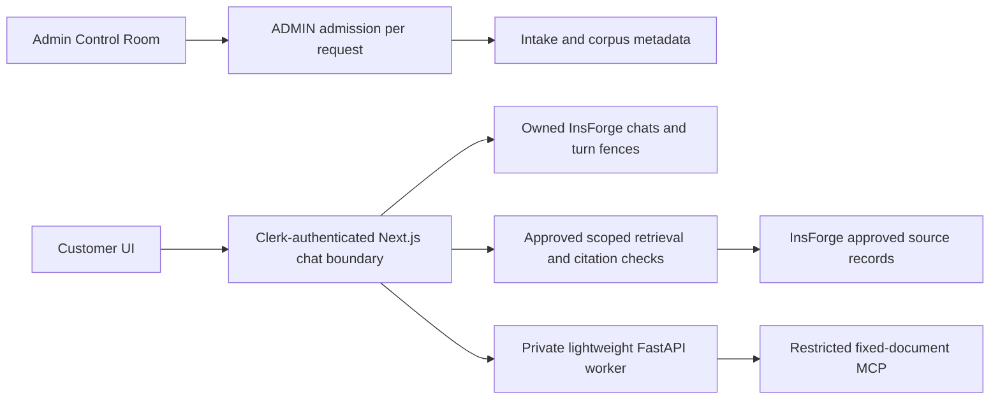
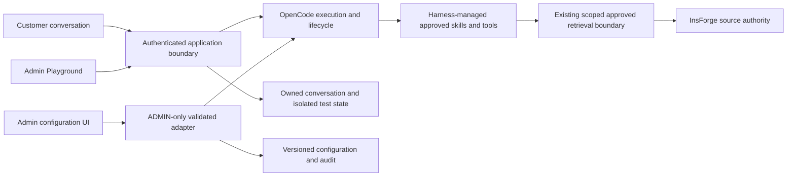

# Agent Experience Upgrade: architecture and transition

Status: proposed target; current behavior is described separately below. See [capability contract](capability-contract.md) for source evidence and unverified interfaces. The [requirements authority](requirements.json) is the sole task and coverage store.

## Current mounted path

The active path uses the lightweight worker, deterministic/finite workflows and an application-owned restricted MCP fetch. The Admin evaluation endpoint is unavailable. The preserved OpenCode selector and spike are not mounted here. Phase 6 is in progress, with its broad held-out evaluation gate unresolved; no diagram represents that gate as passed.

## Target ownership

This is a responsibility diagram, not an implemented deployment topology or evidence that a specific OpenCode transport is already connected. OpenCode owns orchestration, model execution, supported skills and MCP/tool operations. The application owns identity, current permissions, approved knowledge, source-fenced citations, persistence, memory isolation and safe projections. Admin owns configuration and test presentation. An adapter translates only verified native interfaces; it does not execute a second agent loop or implement a separate MCP protocol client. The existing application retrieval boundary remains the single knowledge authority for both interfaces.

## Decisions and transition safeguards

1. The latest master prompt directs restoration of OpenCode ownership. Earlier replacement-only instructions governed the historical Phase 6 checkpoint; preserve that evidence and behavior while designing a version-aligned transition. Do not rely on old code alone: the prior OpenCode selector was a bounded no-tool, ephemeral-session integration, not a full skills/MCP Playground.
2. The local CLI is 2.1.3 while preserved client/schema/protocol evidence is 2.2.2. Select and verify one compatible runtime and API version before wiring. The 2.2.2 `config.update` declaration is limited to shell; generic config mutation is not established. Verify runtime permissions, effect and restart behavior before exposing management controls.
3. Maintain the existing application owner/session mapping, durable turn and cancellation protections, approved retrieval and protected source rechecks. Reuse source policy rather than importing the historical broker as an authority: its receipt and current-authorization callbacks must be genuinely provided by the new execution boundary. Multi-source finalization requires its own bounded scope-set validation; do not loosen one-product predicates.
4. Isolate Admin test sessions, histories, memory and grants from customer scope. Default-deny external side effects and unreviewed tools; Admin membership and UI visibility do not replace enforcement in the harness and data services. Use redacted allowlisted events and status-only reconciliation when execution is uncertain.
5. Keep the current FastAPI path and its artifacts intact during offline contract work. Do not silently fall back between engines after a failed or ambiguous dispatch. A future cutover requires a deliberate versioned selection, verified current configuration, migration/ownership and rollback plan, plus genuine lifecycle and isolation checks. On rollback, stop new admissions to the changed path, reconcile or retain unknown in-flight work, then restore the previously verified selection without deleting journals, chats or evidence. No deployment is authorized by this document.
6. Customer project memory remains bounded owner-scoped intent, never authority for withdrawn source facts. No Mem0 processing is designed or enabled until the missing separately referenced plan supplies data-flow, isolation and retention decisions. Development memory remains separate.

The smallest first increment is offline fixture-backed contract testing of session mapping, authorization, events, source fences and cancellation/reconciliation using real versioned protocol shapes. It cannot establish live execution, provider quality, extension operations or the unresolved Phase 6 evaluation. Progress and implementation evidence belong in the existing requirement store and handoff.
