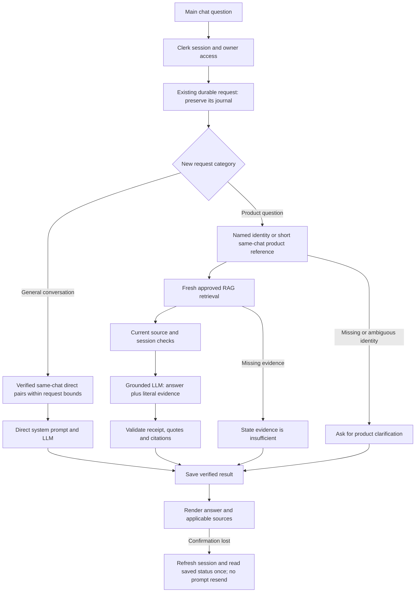

# Panda Agent: grounded conversation task breakdown

10 November 2026. One bounded EGM-assisted analysis of the existing feature; no new product architecture or production changes are authorized by this document.

## Goal and current boundary

Connect the working RAG Control Room retrieval system to Panda Agent's main conversation. Product facts must come from currently approved evidence, with citations. General questions may use eligible verified direct pairs from the same chat, excluding RAG turns and subject to request-bound truncation. Reuse the current Next.js, Clerk, InsForge PostgreSQL, OpenRouter Luna/Azure and existing UI. Keep AWS/OpenCode harness expansion separate.

The owner asked for this connection and coordination with the RAG Control Room chat. That chat owns implementation, migrations, deployment and the shared release handoff. This chat owns independent acceptance checks and this breakdown. Preserve unfinished native work in the original checkout. Do not reset, stash or overwrite it. `requirements.json` remains the requirement/status authority; this analysis does not create a second requirement register or complete broader Phase 1 acceptance.

## EGM installation and use

- Source: https://github.com/google/elephant-goldfish-model ; fetched revision `6d2af49f635515a472ce0dbba375c62b73dace26`.
- Installed `egm@egm` version `0.1.1`, enabled; license Apache-2.0.
- Installed bundle: `C:/Users/rajra/.codex/plugins/cache/egm/egm/0.1.1`.
- EGM is a development design/review workflow, not an inference model. It does not change Panda Agent's provider/model, add a runtime MCP connection or consume the app's OpenRouter budget.
- Normal skill discovery requires a fresh Codex session. For this requested breakdown, the parent reads the installed instructions and directly dispatches isolated reviewers using bundled personas and standards. This is one bounded review, not a claim of full multi-round EGM convergence or native activation testing.
- Review configuration: target this full file; personas `implementation_readiness` and `structural`; standard `implementation-readiness-standard`; fresh contexts without parent turns. Project instructions and shared filesystem isolation remain outside that guarantee. Reviewers must not read credentials, memories or unrelated chat history.

## Workflow

## Tasks, ownership and exit evidence

| Task | Owner | State | Exact boundary and required check |
| --- | --- | --- | --- |
| 1. Reuse Control Room retrieval | RAG chat | Implemented and tested | `Panda-agent/src/server/main-rag-chat.ts` calls existing catalog/snapshot/product-context preparation. No second retrieval engine or index. Existing frozen retrieval cases remain separate from generation acceptance. |
| 2. Route and bind durable requests | RAG chat | Implemented and tested | Main router retains existing RAG/direct/legacy status and cancellation ownership. New product requests cannot fall through to general generation after RAG failure. Unknown products clarify or report insufficient evidence. |
| 3. Preserve conversational memory | RAG chat; original memory implementation retained | Tested | `direct-conversation-history.ts` and the additive direct-memory migration keep up to six eligible direct pairs under the existing serialized request bound. Raw RAG answers are excluded from direct memory. No cross-chat memory. |
| 4. Ground product follow-ups | RAG chat; independent reviewer | Corrected and live-tested | `resolveMainFollowupScope` carries only identity from the latest eligible masked same-thread cited answer. Retrieve fresh evidence and recheck the history anchor and live catalog before dispatch/publication. USB, Bluetooth, supply, price, stock and temperature routing regressions. |
| 5. Enforce evidence/privacy | RAG chat; independent reviewer | Tested within listed scope | `luna-rag-openrouter.ts`, `basic-rag.ts`, `basic-rag-chat-service.ts` preserve exact provider/ZDR, usage receipt, literal quotes, current source/session checks, and cancellation fences. Format instructions must match server citation validation. No weakening validators or automatic generation retries. |
| 6. Recover lost completion confirmation | RAG chat | Verified and deployed | Actual boundary: `Panda-agent/src/ui/reconcile-answer.ts`, `Panda-agent/src/ui/workspace.tsx`, `Panda-agent/tests/reconcile-answer.test.mjs`. Final source `94cf4ec`; combined 234-test pack passed. The owning chat recorded live one-POST/one-GET recovery and fresh-token 401-to-200 recovery in the release evidence. No prompt resend. |
| 7. Publish and verify the combined checkpoint | RAG chat plus root publication | Verified and published | Source `94cf4ec` and release evidence `7d13ed9` are on main; scoped coverage was added as `8d6eba6`. Ready/promoted recovery deployment `dpl_GxKywCmkQb1EPE3VJ2ettwAwb5G3` is linked to the source in the release record. Shared handoff/current_RAG.md updated; native work preserved. |

## Actual problems found and disposition

1. **Product identity was absent from follow-ups.** `What is its USB connector?` initially saved a request for the product name; Bluetooth/price/stock questions could route direct. Fixed by identity-only same-thread selection and guarded fresh retrieval. Source withdrawal or ambiguous/masked history must block reuse.
2. **Citation-format instructions conflicted with output validation.** The transport asked the model to cite claims while the application attaches citation markers itself. Instructions were corrected; quote/receipt validation remains. This was a plausible reliability risk, not proven to be the sole cause of every failed request.
3. **An original xC3 request remained claimed/pending without a saved answer.** It was not retried. Logical cancellation was observed after reload, retaining history and allowing the chat to continue. Fresh distinct xC3 requests were tested by the RAG chat.
4. **A successful answer briefly appeared interrupted/unavailable.** The final independent x8266 request was already durably saved; browser reload recovered the cited answer without another model call. Source `94cf4ec` adds bounded read-only reconciliation. The owning chat subsequently verified deliberate lost-frame recovery on the live domain with one model POST and one exact-request GET, plus capabilities 401-to-200 fresh-token recovery. This proves the tested cases, not the absence of every future network failure.
5. **Retrieval speed and complete-answer speed differ.** RAG chat measured candidate context delivery at 1.11–1.69 seconds; the independent final primary-domain message requests completed at 5.026 and 9.053 seconds. These are small samples, not an SLA or a clean latency distribution.

## Recovery acceptance and publication gate

Task 6 implements a five-second operation bound covering token refresh and read, one fresh `getToken({skipCache:true})`, and at most one GET to an allowlisted same-origin capabilities endpoint or exact chat UUID plus request UUID. `workspace.tsx` retains the active attempt/unmount guard. The final automated and owning-chat live evidence is in `Panda-agent/docs/verification/main-chat-rag-20261110.json`; this chat independently inspected the source and tested the cited/reload path, while the other chat performed the controlled fault checks.

The owning chat must record passing `reconcile-answer.test.mjs` cases for: exact completed request with a different assistant message UUID; pending/absent/missing status; foreign/busy thread; malformed/empty answer; 401/403/404/503; missing/invalid token; cancellation/unmount/account or attempt change during refresh, fetch and parse; redirect/non-JSON/parse failure; disallowed endpoint; and five-second timeout. Expected outcomes: only the exact server-proven complete request in the current idle thread may restore a saved answer; every uncertain/stale/denied case remains unresolved, performs no second GET loop and never sends a message POST. Existing cancel/status review guards remain.

Task 7 may close only after Task 6's exact final file list and passing tests are recorded, reviewed source is committed, that exact source checkpoint is identified in the Ready/promoted Vercel release, and main contains it. A failed or unknown check keeps closeout pending. Existing already-promoted integration remains a separate prior checkpoint, not evidence for an unshipped recovery change.

| Scenario | Expected observable outcome | Acceptance owner/evidence |
| --- | --- | --- |
| Named product | Approved fact plus literal-backed citation, durable saved answer | RAG chat staged/live report; this chat independently observed final x8266 answer in `tmp/combined-rag-independent-final.json` |
| Same-chat USB follow-up | Correct previous product identity, freshly retrieved evidence, cited Type-C answer | This chat independently observed final live follow-up and reload in the same JSON |
| Unsupported hardware safety | Insufficient evidence; no invented voltage or general fallback | RAG chat's reported staged/live case; require sanitized final release record before closeout |
| General memory beside RAG | Eligible direct preferences recalled; no raw RAG answer fed as general evidence | Prior memory release evidence plus RAG chat's reported combined case; require current release record |
| Saved reload | Same saved named/follow-up answer and citations remain | Independently observed on deployment `dpl_3GVj1mZE12rjgyVLrLSjCC3CtnJk`; no prompt resend |
| Cancel uncertain request | Retained cancelled history, composer usable, no late answer/retry | Independently observed original xC3 recovery after RAG chat's logical cancellation |
| Token/confirmation recovery | Fresh token and one current-request read restore only proven saved result; zero duplicate generation | Owning chat's final release evidence records helper tests, one-POST/one-GET lost-frame recovery and capabilities 401-to-200 recovery |

Per-task evidence attribution: Tasks 1–2 and 5 currently cite the implementing chat's 217-test report and source inspection, not an independent full regression run. Task 3 has `conversation-memory-release-verification.json` for the prior direct release; combined behavior is reported by the RAG chat. Task 4 has direct independent live x8266/USB evidence plus the implementing chat's routing/source-revalidation tests. Neither source inspection nor private-input skips substitute for live withdrawal, isolation, or every-model acceptance. The final sanitized release record must supply exact test identifiers and final commit/deployment mapping; retain any unavailable check as unverified.

## Verified checkpoint

- Corrected grounded code: `2521be5`, following integration `abe8d79` and memory-preservation `8e8b5c7`; final recovery source `94cf4ec`, release evidence `7d13ed9`, scoped requirement coverage `8d6eba6`, all published to main.
- Independently confirmed current Ready primary deployment: `dpl_GxKywCmkQb1EPE3VJ2ettwAwb5G3`, URL https://pandabyte-iot.vercel.app/panda-agent. Independent named/follow-up/reload generation checks were performed on the preceding corrected grounded deployment `dpl_3GVj1mZE12rjgyVLrLSjCC3CtnJk`; controlled recovery and final context timing were performed by the RAG chat on the current release.
- Independent Codex Browser: x8266 -> ESP8266 with S1; then `What is its USB connector?` -> USB Type-C with S1; both retained after reload. Four supplied fragments, 2,471 characters on the follow-up.
- Original uncertain xC3 test was logically cancelled; no automatic generation retry.
- Implementing chat's final release records 234 passing tests, zero skips, plus TypeScript, lint and production build. Both frozen 20-case retrieval regressions passed. Independent limited checks were run separately; private-input skips in those checks are not counted as complete private-source coverage.
- Private, ignored independent artifacts: `tmp/combined-rag-independent-before-fix.json`, `tmp/combined-rag-independent-final.json`, and `tmp/panda-agent-rag-live-verified.jpg` in the original native checkout. They contain test evidence, not credentials; only sanitized release records may be published.

## Constraints, limits and exact next step

Strict ZDR and owner/Admin access remain required. The RAG Control Room's separate latest human testing instruction authorized no cumulative hosted testing cap; that chat owns those settings. The historical local/native USD1 ledger must remain untouched and must not be represented as reset or refunded. No general public inference access, account-wide privacy changes, new credentials, RAG importer changes, native harness expansion or commerce changes are introduced here.

Implicit product references are currently bounded to short interrogative questions (up to 240 characters and 24 words) and require the latest eligible cited product answer. Generation currently supports one product; passing multi-product retrieval cases does not establish multi-product answer generation. Long-term Mem0, arbitrary cross-turn semantic reference resolution and full OpenCode execution are separate work.

Next action: the owner can test the released demo and report observed failures. Final code/deployment, measured context delivery (1.86 seconds for the final sample) and full response time (10.36 seconds) are in the shared handoff and release record. No new code change, model replacement or harness phase is implied by this EGM breakdown. The analysis received one diagnostic review round; corrections were not reviewed to EGM convergence.
